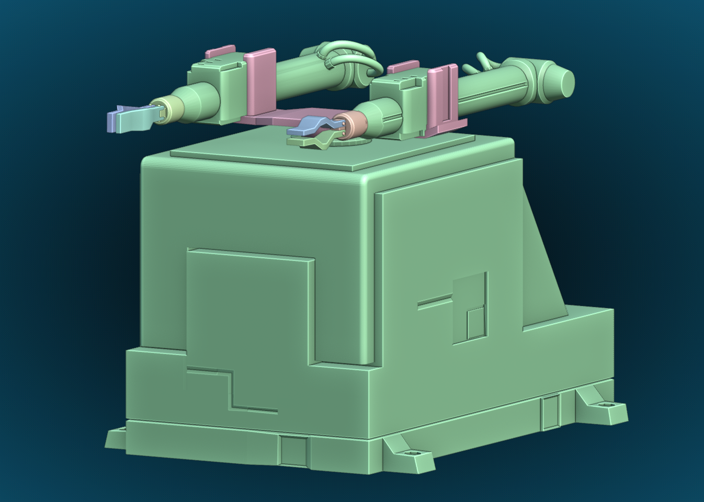
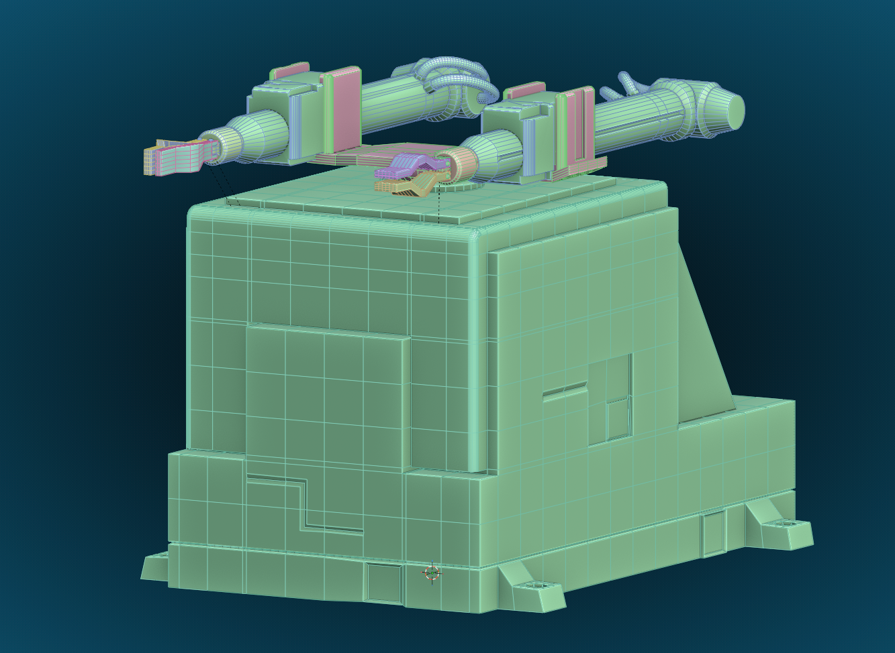
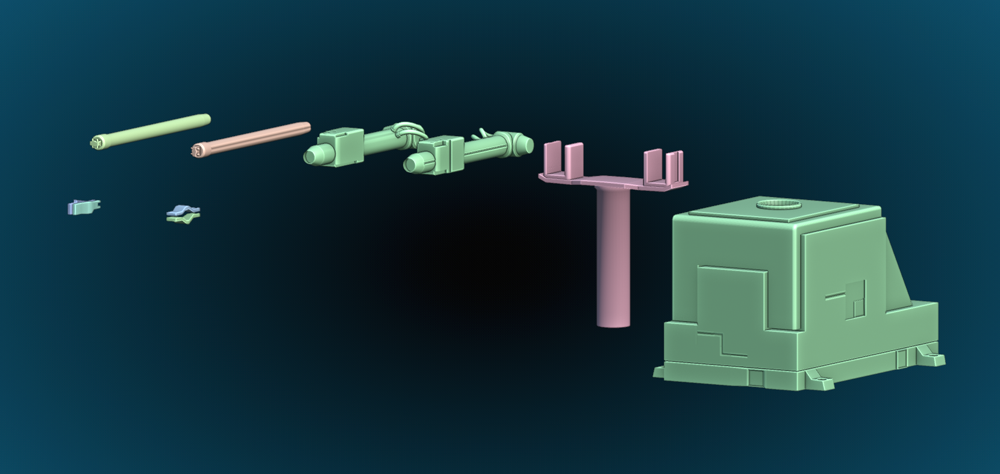

# Лабораторная работа №3: Создание 3D-модели в Blender

Расположение модели: `assets/blender_model/`
* `Cyclone-5.blend` — исходник Blender.

## Цель
Создать в Blender 3D-модель промышленного робота по варианту с сохранением дробления по типу и группе движения для первых трех степеней подвижности.

## Основные идеи
Передать общую форму конструкции по референсу и правильно разделить её на подвижные части. Эта структура будет служить основой для последующего импорта модели в OpenGL, настройки тектур освещения и реализации движения в следующих лабораторных работах.

## Реализовано
* Создана 3D-модель промышленного робота-манипулятора (Циклон-5).
* Подвижные элементы разделены на отдельные группы для трех степеней подвижности.
* Подготовлена иерархия зависимых частей (parenting), чтобы дочерние элементы наследовали движение родителя.
* Добавлены ограничения трансформаций (constraints) для контроля движения частей модели.
* **Дополнительно:** смоделированы и настроены клешни-захваты на концах рук для реализации функции захвата предметов.

## Структура модели и иерархия
Иерархия объектов организована следующим образом:

* **Collection**
  * **Неподвижная_платформа**
  * **Левая рука**
    * **Рука_1**
      * Cylinder.003
      * Клешня_1
      * Клешня_2
  * **Правая рука**
    * **Рука 2**
      * Cylinder.006
      * Клешня_1.1
      * Клешня_2.2
  * **Станина**
    * Constraints 
    * Cube.003
    * **Насос_поршня**
      * Cylinder.001
      * Рука_2
      * Рука_1

## Особенности реализации (Цепочка ограничений)
Ограничения заданы через модификаторы трансформаций Blender (Constraints). Логика движения выстроена следующим образом:

* **База (Неподвижная_платформа):** 
  * Является точкой отсчёта, не имеет ограничений и остается статичной.
* **1-я степень (Станина — Поворот):** 
  * **Вращение:** `Limit Rotation` по локальной оси Z (ограничение от -90° до 90°).
* **2-я степень (Насос_поршня — Подъем):** 
  * **Вертикальное перемещение:** `Limit Location` по локальной оси Z. Ограничение подъема модуля составляет 25 см (от 0 до 25 см).
* **3-я степень (Рука_1 и Рука 2 — Выдвижение):** 
  * **Линейное перемещение:** `Limit Location` по локальной оси. 
  * *Примечание:* Для лучшей визуальной составляющей и наглядности демонстрации выдвижения, длина хода рук была увеличена до **150 см** (в отличие от 60 см, указанных в чертеже).
* **Дополнительно (Клешни-захваты):** 
  * **Раскрытие/Закрытие:** Для парных элементов (`Клешня_1` / `Клешня_2` и `Клешня_1.1` / `Клешня_2.2`) настроен `Limit Rotation` по локальной оси X. Для левой и правой половинки заданы противоположные значения ( от 0° до 20° и от -20° до 0°) для эффекта захвата.

> Во всех ограничениях активирована функция `Affect Transform` для предотвращения выхода координат за заданные пределы в меню свойств.

## Результат
Подготовлена 3D-модель робота Циклон 5, разбитая на подвижные части, с настроенной кинематикой.

## Визуализация

**Общий вид**

**Сетка**

**Детали модели**

