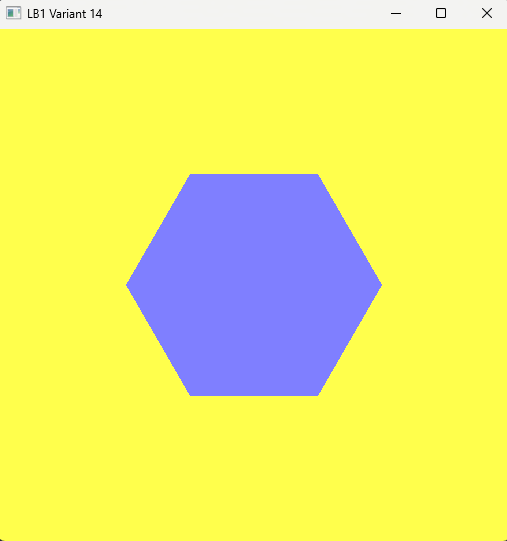

# Лабораторная работа №1. OpenGL: окно, контекст, первая фигура

Вариант **14**: шестиугольник.

| Параметр | Значение (r, g, b) |
|---|---|
| Цвет фигуры | (0.5, 0.5, 1.0) |
| Цвет фона | (1.0, 1.0, 0.3) |

## Задание

Подготовить проект в Visual Studio для работы с OpenGL, создать окно с графическим контекстом и вывести на экран фигуру своего варианта. В работе используется классический режим OpenGL 1.0 (`glBegin` / `glEnd`).

## Окружение

- Visual Studio, сборка Debug x64
- GLFW 3.5.1: создание окна, контекста и обработка событий
- GLEW 2.3.1: загрузка функций OpenGL
- Оба проекта подключены статически: `glfw3.lib` в зависимостях линкера, `glew.c` добавлен прямо в проект, в настройках задан макрос `GLEW_STATIC`

## Как устроена программа

1. **Запуск GLFW.** Проверяется результат `glfwInit()`, при ошибке программа завершается.
2. **Версия OpenGL.** Через `glfwWindowHint` запрашивается версия 1.0, строки с `FORWARD_COMPAT` и `CORE_PROFILE` оставлены закомментированными, иначе `glBegin` работать не будет.
3. **Окно и контекст.** Окно 512 × 512 создаётся через `glfwCreateWindow`, контекст делается текущим функцией `glfwMakeContextCurrent`.
4. **Запуск GLEW.** `glewInit()` вызывается после создания контекста, результат проверяется.
5. **Вывод информации.** В консоль печатаются версия GLEW, версия OpenGL и название видеокарты.
6. **Главный цикл** работает, пока окно не закрыто. На каждом кадре порядок такой: задать цвет фона и очистить кадр, нарисовать фигуру, поменять буферы (`glfwSwapBuffers`), обработать события (`glfwPollEvents`).
7. **Завершение.** После выхода из цикла вызывается `glfwTerminate()`.

## Как строится шестиугольник

Окно использует стандартные координаты OpenGL: от −1 до 1 по обеим осям, центр в точке (0, 0). Шестиугольник вписан в окружность радиуса `R = 0.5`. Вершины лежат на ней через каждые 60° (π/3):

```
x = R · cos(a),   y = R · sin(a),   a = i · π/3,   i = 0…5
```

Фигура собрана из шести треугольников, у которых общая вершина в центре. Треугольник номер `i` образован центром и двумя соседними вершинами на окружности (с углами `i·π/3` и `(i+1)·π/3`). Рисуются они в режиме `GL_TRIANGLES`, цвет задаётся один раз функцией `glColor3f` перед вершинами.

## Результат

В окне отображается сиреневый шестиугольник на жёлтом фоне.



## Замечания

- Запрошена версия 1.0, но драйвер вернул более новый совместимый контекст (4.6.0). Это нормально: подсказка версии означает «не ниже», а в совместимом контексте функции `glBegin` / `glEnd` продолжают работать.
- В методических указаниях исправлены неточности: функция обработки событий называется `glfwPollEvents` (в тексте `glfwPullEvents`), а `glColor3f` вызывается до вершин, чтобы цвет применялся ко всем.
- Макросы `GLEW_DLL` и `GLFW_DLL` не используются, так как библиотеки подключены статически.