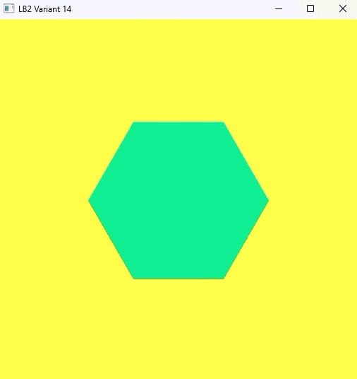

# Лабораторная работа №2. Современный OpenGL 4.6: VAO, VBO, EBO и шейдеры

Вариант **14**: шестиугольник.

## Цель

Перейти от классического рендера на `glBegin` / `glEnd` к современному OpenGL: хранить геометрию в буферах видеокарты (VBO, EBO), описывать формат вершин в VAO и выводить фигуру через шейдерную программу. Добавить анимацию фигуры во времени и написать собственную библиотеку для работы с шейдерами.

## Основные идеи

В первой лабораторной вершины отправлялись на видеокарту по одной в момент рисования. Здесь все данные загружаются в видеопамять один раз:

- **VBO** хранит координаты вершин;
- **EBO** хранит индексы, по которым из этих вершин собираются треугольники, поэтому общие вершины не дублируются;
- **VAO** запоминает, как читать данные из буфера, и позволяет перед рисованием подключить всё одним вызовом;
- **шейдеры** на языке GLSL заменяют фиксированный конвейер: вершинный шейдер отвечает за позицию, фрагментный за цвет пикселей.

Для запроса Core Profile включены `GLFW_OPENGL_FORWARD_COMPAT` (`GL_TRUE`) и `GLFW_OPENGL_CORE_PROFILE`. Из-за этого `glBegin` и `glEnd` в программе больше не работают.

## Окружение

- Visual Studio, сборка Debug x64
- OpenGL 4.6 Core Profile 
- GLFW 3.5.1 и GLEW 2.3.1, оба подключены статически
- GLSL `#version 410 core`

## Геометрия шестиугольника

Шестиугольник вписан в окружность радиуса 0.5. Вершин **7**: центр и шесть точек по окружности. Из них собираются **6 треугольников**, у каждого общая вершина в центре. Поэтому индексов **18** (6 × 3), и отрисовка выглядит так:

```cpp
glDrawElements(GL_TRIANGLES, 18, GL_UNSIGNED_INT, 0);
```

| Индекс | Координаты (x, y) |
|---|---|
| 0 | (0, 0): центр |
| 1 | (0.5, 0) |
| 2 | (0.25, 0.433) |
| 3 | (−0.25, 0.433) |
| 4 | (−0.5, 0) |
| 5 | (−0.25, −0.433) |
| 6 | (0.25, −0.433) |

Индексы треугольников: `0 1 2`, `0 2 3`, `0 3 4`, `0 4 5`, `0 5 6`, `0 6 1`.

## Задание 1. Цвет, зависящий от времени

Цвет фигуры передаётся во фрагментный шейдер через `uniform vec4 ourColor`. Каждый кадр на CPU вычисляется новое значение по времени работы программы `t = glfwGetTime()`:

```cpp
r = sin(t)        * 0.5 + 0.5;
g = sin(t + 2.0)  * 0.5 + 0.5;
b = sin(t + 4.0)  * 0.5 + 0.5;
```

`sin` возвращает значения от −1 до 1, поэтому результат приводится к диапазону 0…1 (`* 0.5 + 0.5`). У каждого канала свой сдвиг фазы, поэтому цвет не просто «мигает», а плавно проходит через разные оттенки. Период цикла около 6,3 секунды.

## Задание 2. Своя библиотека для шейдеров (`Shader.h`)

Текст шейдеров вынесен из кода в файлы `shaders/shader.vert` и `shaders/shader.frag`. Класс `Shader`:

- читает файлы шейдеров (с удалением BOM, если редактор его добавил);
- компилирует вершинный и фрагментный шейдеры и проверяет результат через `glGetShaderiv` и `glGetShaderInfoLog`;
- линкует программу и проверяет результат через `glGetProgramiv` и `glGetProgramInfoLog`;
- имеет методы `use()` и `remove()`;
- передаёт `uniform` одной строкой:

```cpp
Shader shader("shaders/shader.vert", "shaders/shader.frag");
...
shader.use();
shader.setVec4("ourColor", r, g, b, 1.0f);
```

Реализованы методы: `setBool`, `setInt`, `setFloat`, `setVec2`, `setVec3`, `setVec4`, `setMat4`.

### Варианты передачи uniform по количеству элементов и типу

| Функция OpenGL | Что передаёт | Тип в GLSL |
|---|---|---|
| `glUniform1f` / `2f` / `3f` / `4f` | 1–4 числа `float` | `float`, `vec2`, `vec3`, `vec4` |
| `glUniform1i` / `2i` / `3i` / `4i` | 1–4 числа `int` | `int`, `ivec2`…, `bool`, `sampler2D` |
| `glUniform1ui` / `2ui` / `3ui` / `4ui` | 1–4 числа `unsigned int` | `uint`, `uvec2`… |
| `glUniform1fv` / `2fv` / `3fv` / `4fv` | массив значений `float` | массивы и `vecN` |
| `glUniformMatrix2fv` / `3fv` / `4fv` | матрица | `mat2`, `mat3`, `mat4` |

## Структура

```
LB2/
├── LB2.cpp            основная программа
├── Shader.h           библиотека для работы с шейдерами
└── shaders/
    ├── shader.vert    вершинный шейдер
    └── shader.frag    фрагментный шейдер
```

## Результат

На жёлтом фоне `(1.0, 1.0, 0.3)` отображается шестиугольник, цвет которого плавно переливается со временем.



