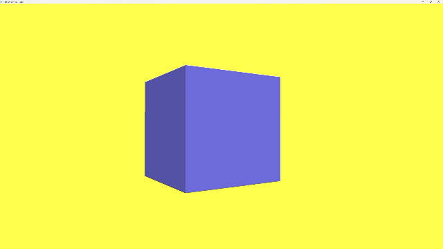

# Лабораторная работа №4. Камера и матрицы: библиотека glm

Реализовать управление камерой в 3D-сцене с использованием матриц и библиотеки GLM.

## Задача

Превратить плоскую сцену из предыдущих работ в трёхмерную: добавить матрицы проекции и вида, подключить библиотеку **GLM** и сделать камеру, которой можно управлять с клавиатуры и мыши. Для демонстрации выводится куб.

## Окружение

- Visual Studio, сборка Debug x64
- OpenGL 4.6 Core Profile, GLSL `#version 410 core`
- GLFW 3.5.1 и GLEW 2.3.1 (статическое подключение)
- GLM: библиотека только из заголовочных файлов, подключена через Additional Include Directories
- Класс `Shader` из лабораторной работы №2 (загрузка шейдеров из файлов и передача `uniform`)

## Структура

```
LB4/
├── LB4.cpp            основная программа: камера, ввод, куб
├── Shader.h           загрузка шейдеров и передача uniform
└── Shader/
    ├── shader.vert    вершинный шейдер (матрицы)
    └── shader.frag    фрагментный шейдер (цвет)
```

## Путь вершины на экран

Вершины куба заданы в локальных координатах (от −0,5 до 0,5). Вершинный шейдер переводит их на экран четырьмя матрицами:

```glsl
gl_Position = projection * view * model * transform * vec4(aPos, 1.0);
```

Матрицы применяются справа налево:

| Матрица | Что делает | Как задана |
|---|---|---|
| `transform` | фиксированный поворот куба | `glm::rotate`, 30° вокруг оси Y |
| `model` | положение объекта в мире | единичная матрица (куб в начале координат) |
| `view` | положение и направление камеры | `glm::lookAt(cameraPos, cameraPos + cameraFront, cameraUp)` |
| `projection` | перспектива | `glm::perspective(45°, ширина/высота, 0.1, 100)` |

Соотношение сторон для `projection` считается каждый кадр по размеру окна, поэтому при изменении размера куб не растягивается. Матрицы передаются в шейдер через `shader.setMat4(...)` и `glm::value_ptr(...)`.

## Камера

Камера задаётся тремя векторами:

| Переменная | Начальное значение | Смысл |
|---|---|---|
| `cameraPos` | (0, 0, 3) | положение камеры (точка) |
| `cameraFront` | (0, 0, −1) | направление взгляда (вектор) |
| `cameraUp` | (0, 1, 0) | направление «вверх» |

Точка, на которую смотрит камера, считается как `cameraPos + cameraFront`, поэтому взгляд не привязан к началу координат и следует за камерой.

## Управление

| Действие | Клавиши и мышь |
|---|---|
| Движение вперёд и назад | `W` / `S` |
| Движение влево и вправо | `A` / `D` |
| Поворот взгляда | движение мыши |
| Режим каркаса вкл/выкл | `F` |
| Выход | `Esc` |

Курсор скрыт и закреплён внутри окна (`GLFW_CURSOR_DISABLED`).

### Движение

`W` и `S` смещают камеру вдоль `cameraFront`. Для `A` и `D` берётся вектор «вправо» как нормализованное векторное произведение `cross(cameraFront, cameraUp)`. Шаг равен `2.5 * deltaTime`, где `deltaTime` это время последнего кадра, поэтому скорость (2,5 единицы в секунду) не зависит от частоты кадров.

### Поворот мышью

В обработчике движения мыши смещение курсора с прошлого события умножается на чувствительность 0,1 и добавляется к углам `yaw` (рыскание) и `pitch` (тангаж). Угол `pitch` ограничен диапазоном от −89° до 89°: при 90° вектор взгляда совпал бы с вектором «вверх», и `lookAt` переворачивался бы. Из углов вычисляется направление взгляда:

```
x = cos(yaw) · cos(pitch)
y = sin(pitch)
z = sin(yaw) · cos(pitch)
```

Начальное значение `yaw = −90°` даёт `cameraFront = (0, 0, −1)`, то есть камера сразу смотрит на куб. Флаг `firstMouse` убирает резкий скачок камеры при первом движении мыши.

## Куб

- В буфере **24 вершины** (6 граней по 4): у каждой грани свой оттенок, поэтому одну и ту же угловую точку приходится описывать отдельно для каждой из трёх граней.
- **36 индексов** в EBO (6 граней × 2 треугольника × 3 вершины), отрисовка `glDrawElements(GL_TRIANGLES, 36, ...)`.
- Цвет грани это цвет варианта (0.5, 0.5, 1.0), умноженный на коэффициент яркости грани. Так при одном цвете куб не выглядит плоским силуэтом, хотя освещения пока нет.
- Включён **тест глубины** (`GL_DEPTH_TEST`), буфер глубины очищается вместе с цветом каждый кадр. Без него ближние и дальние грани перекрывали бы друг друга в порядке рисования.

## Способы задания ориентации 

| Способ | Идея | Использован |
|---|---|---|
| Look-At | ориентация по точке, на которую смотрит камера | да, построение матрицы `view` |
| Углы Эйлера | три угла (yaw, pitch, roll) | да, yaw и pitch для мыши |
| Кватернионы | вращение без блокировки осей и с плавной интерполяцией | нет |

Крен (`roll`) не используется. Ограничение угла `pitch` защищает от вырождения `lookAt`, которое возникает при взгляде вертикально вверх или вниз.

## Отличия от методических указаний

- Библиотека **glad** не подключалась: функции OpenGL загружает GLEW, который уже использовался в предыдущих работах.
- Начальное значение `yaw` задано равным −90°, иначе камера сразу смотрела бы вправо.
- Скорость камеры привязана ко времени кадра (`deltaTime`), а не к фиксированному шагу на кадр.
- Переключение каркаса и выход обрабатываются через `glfwSetKeyCallback` (срабатывает один раз при нажатии), движение через опрос `glfwGetKey` (каждый кадр).

## Результат

Реализована 3D-навигация по сцене: куб отображается в перспективе, камера свободно перемещается и поворачивается, режим каркаса показывает рёбра и треугольники.

