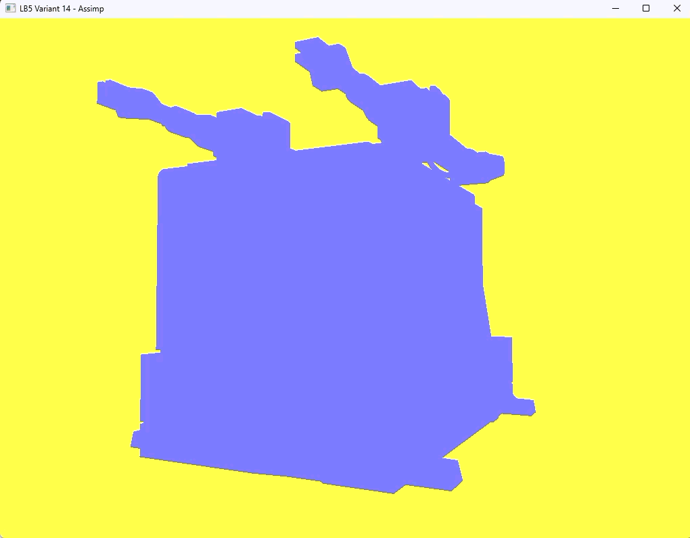

# Лабораторная работа №5

**Подключение и работа с библиотекой ASSIMP. Настройка импорта модели.**

## Цель

Подключить библиотеку ASSIMP и написать фрагмент программы для импорта модели в формате `.obj` с возможностью дальнейшей работы с ней: отрисовать собственную модель робота «Циклон-5», экспортированную из Blender.

## Окружение

- Visual Studio, платформа x64
- OpenGL 4.6 Core Profile
- GLFW, GLEW (статическая линковка, `GLEW_STATIC`), GLM
- Assimp (в репозиторий скопированы `include`, `lib\x64` и `bin\x64`)
- Вариант **14**: цвет фигуры (0.5, 0.5, 1.0), цвет фона (1.0, 1.0, 0.3)

### Подключение Assimp в свойствах проекта

| Где | Значение |
|---|---|
| C/C++ → General → Additional Include Directories | `$(SolutionDir)Assimp\include` |
| Linker → General → Additional Library Directories | `$(SolutionDir)Assimp\lib\x64` |
| Linker → Input → Additional Dependencies | `assimp-vc145-mt.lib` |
| Debugging → Working Directory | `$(ProjectDir)` |
| Build Events → Post-Build Event → Command Line | `xcopy /y /d "$(SolutionDir)Assimp\bin\x64\assimp-vc145-mt.dll" "$(OutDir)"` |


## Как устроена программа

Модель загружается через Assimp в объект сцены `aiScene`. Данные из сцены переносятся в собственные классы, которые готовят геометрию к отрисовке в OpenGL.

```
Scene → Node → Mesh → Face / Vertex
```

| Файл | Назначение |
|---|---|
| `LB5.cpp` | окно и контекст OpenGL 4.6 Core, камера из ЛР4, главный цикл, передача матриц и цвета в шейдер |
| `Mesh.h` | структура `Vertex` (позиция и нормаль) и класс `Mesh`: настройка VAO / VBO / EBO, отрисовка `glDrawElements` |
| `Model.h` | класс `Model`: `loadModel` (чтение файла через `Assimp::Importer::ReadFile`), `processNode` (рекурсивный обход узлов), `processMesh` (извлечение вершин, нормалей и индексов) |
| `Shader.h` | класс `Shader` из предыдущих лабораторных |
| `shaders/model.vert` | вершинный шейдер: `projection * view * model * vec4(aPos, 1.0)` |
| `shaders/model.frag` | фрагментный шейдер: плоская заливка цветом `uniform vec3 lightColor` |

Порядок загрузки:

1. `Importer::ReadFile` читает `.obj` с флагами `aiProcess_Triangulate` и `aiProcess_GenSmoothNormals`.
2. `processNode` рекурсивно обходит узлы, начиная с корневого `mRootNode`.
3. `processMesh` копирует позиции, нормали и индексы граней в `std::vector<Vertex>` и `std::vector<unsigned int>`.
4. Из этих данных создаётся объект `Mesh`, который отправляет их в видеопамять.
5. В главном цикле `Model::Draw` отрисовывает все сетки по очереди.

Путь к модели задаётся относительно папки проекта:

```cpp
Model robot("../Assets/Blender_model_Cyclone-5/cyclone-5.obj");
```

## Управление

- **W / A / S / D**: перемещение камеры
- **Мышь**: поворот камеры
- **F**: переключение режима каркаса
- **Esc**: выход

## Результат

Модель в формате `.obj` загружается, разбирается на меши и отображается в сцене OpenGL.

Сплошная заливка цветом и сетка




## Замечания

- Для проверки импорта используется плоская заливка одним цветом через `uniform vec3 lightColor`. Без передачи этого значения модель закрашивается чёрным.
- Нормали вершин уже загружаются и передаются в шейдер (`location = 1`), но пока не используются. Это основа для освещения в следующих работах.
- Экспорт из Blender: `File → Export → Wavefront (.obj)`, оси Forward `-Z` и Up `Y` (по умолчанию), включены Apply Modifiers и Triangulated Mesh. Констрейнты и анимация в `.obj` не переносятся, в файл попадает статичная модель.
- Установленная версия Assimp содержит только Release-библиотеку `assimp-vc145-mt.lib`.
