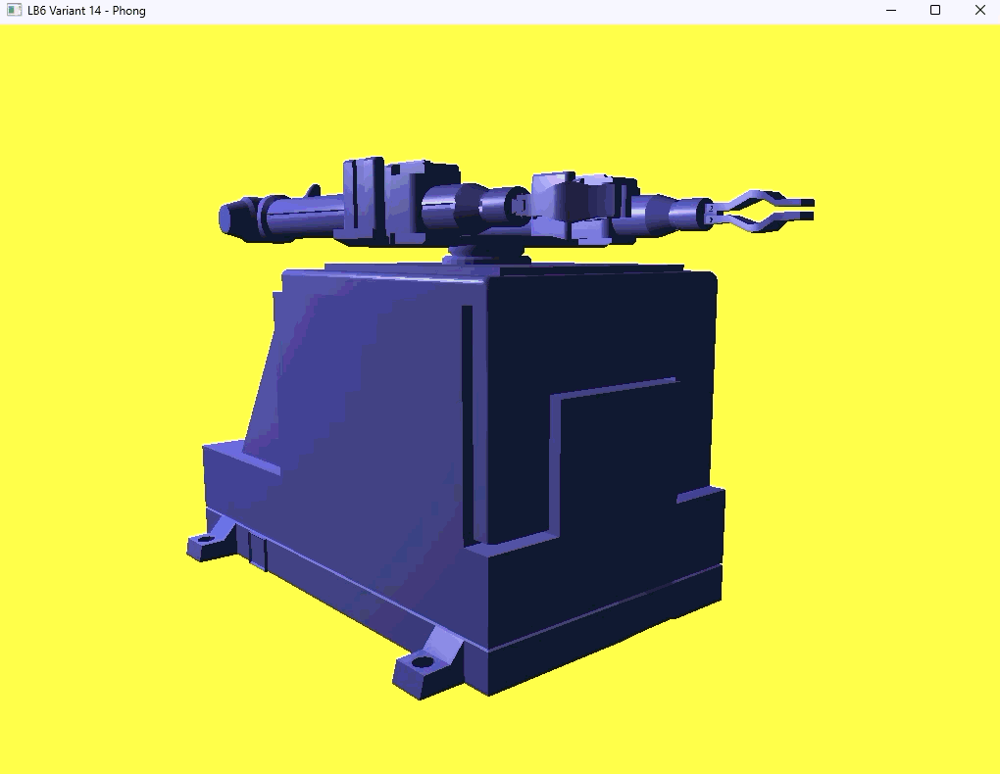

# Лабораторная работа №6

**Настройка освещения с использованием шейдерных программ.**

## Цель

Освоить принципы настройки освещения в OpenGL с использованием шейдеров, включая моделирование окружающего, диффузного и зеркального света на основе модели Фонга. Применить освещение к модели робота «Циклон-5», импортированной через Assimp.

## Окружение

- Visual Studio, платформа x64
- OpenGL 4.6 Core Profile
- GLFW, GLEW (статическая линковка, `GLEW_STATIC`), GLM, Assimp
- Вариант **14**: цвет фигуры (0.5, 0.5, 1.0), цвет фона (1.0, 1.0, 0.3)

Настройки проекта те же, что в ЛБ5:

| Где | Значение |
|---|---|
| C/C++ → General → Additional Include Directories | пути `include` для GLEW, GLFW, GLM и `$(SolutionDir)Assimp\include` |
| C/C++ → Preprocessor → Preprocessor Definitions | `GLEW_STATIC` |
| Linker → General → Additional Library Directories | `$(SolutionDir)glfw-3.5.1.bin.WIN64\lib-vc2026`, `$(SolutionDir)Assimp\lib\x64` |
| Linker → Input → Additional Dependencies | `glfw3.lib;glfw3dll.lib;opengl32.lib;User32.lib;GDI32.lib;Shell32.lib;assimp-vc145-mt.lib` |
| Debugging → Working Directory | `$(ProjectDir)` |
| Build Events → Post-Build Event → Command Line | `xcopy /y /d "$(SolutionDir)Assimp\bin\x64\assimp-vc145-mt.dll" "$(OutDir)"` |

## Как устроена программа

Освещение считается по модели Фонга. Она состоит из трёх компонентов, итоговый цвет точки это их сумма:

| Компонент | Формула | Что даёт |
|---|---|---|
| Окружающий (ambient) | `LightColor * MaterialAmbient` | базовый свет, не даёт теням стать полностью чёрными |
| Диффузный (diffuse) | `LightColor * MaterialDiffuse * max(dot(N, L), 0)` | яркость зависит от угла падения света на поверхность |
| Зеркальный (specular) | `LightColor * MaterialSpecular * pow(max(dot(R, V), 0), Shininess)` | блики на глянцевых поверхностях |

Здесь `N` — нормаль к поверхности, `L` — направление на источник света, `R` — отражённый луч, `V` — направление на камеру.

### Файлы проекта

| Файл | Назначение |
|---|---|
| `LB6.cpp` | окно и контекст OpenGL 4.6 Core, камера из ЛР4, расчёт `normalMatrix`, передача параметров света, материала и положения камеры в шейдер |
| `Mesh.h`, `Model.h` | загрузка модели через Assimp и отрисовка (без изменений по сравнению с ЛБ5, нормали вершин уже передаются в шейдер) |
| `Shader.h` | класс `Shader`; добавлены методы `setMat3` и перегрузка `setVec3` для `glm::vec3` |
| `shaders/model.vert` | вершинный шейдер: передаёт во фрагментный `FragPos` (положение точки в мире) и `Normal` (нормаль через `normalMatrix`) |
| `shaders/model.frag` | фрагментный шейдер: структуры `Material` и `Light`, расчёт трёх компонентов освещения |

### Нормальная матрица

Если умножать нормаль просто на матрицу модели, при неравномерном масштабировании она перестаёт быть перпендикулярной поверхности. Поэтому нормали преобразуются отдельной матрицей:

```cpp
glm::mat3 normalMatrix = glm::transpose(glm::inverse(glm::mat3(model)));
```

В вершинном шейдере: `Normal = normalMatrix * aNormal;`

### Параметры света и материала

Свет и материал описаны структурами в фрагментном шейдере, значения задаются из `LB6.cpp`:

| Параметр | Значение |
|---|---|
| `light.position` | `(3.0, 4.0, 3.0)` |
| `light.ambient` | `(0.2, 0.2, 0.2)`, слабый фоновый свет |
| `light.diffuse` | `(0.8, 0.8, 0.8)`, основной белый свет |
| `light.specular` | `(1.0, 1.0, 1.0)`, блики с полной силой |
| `material.ambient` и `material.diffuse` | `(0.5, 0.5, 1.0)`, цвет фигуры варианта 14 |
| `material.specular` | `(0.5, 0.5, 0.5)` |
| `material.shininess` | `32.0`, резкость блика |

Положение камеры (`viewPos`) передаётся в шейдер каждый кадр и нужно для расчёта бликов.

## Управление

- **W / A / S / D**: перемещение камеры
- **Мышь**: поворот камеры
- **F**: переключение режима каркаса
- **Esc**: выход

## Результат

Модель отображается с освещением по Фонгу: видны фоновая подсветка тёмных сторон, плавный градиент диффузного света и блики на кромках и цилиндрах.



## Замечания

- Нормали вершин берутся из файла модели через Assimp. Если в `.obj` их нет, они создаются автоматически флагом `aiProcess_GenSmoothNormals`.
- Все расчёты освещения выполняются во фрагментном шейдере (по пикселям), поэтому блики получаются гладкими.
- Положение света и интенсивности подбирались под размер модели; при другом масштабе модели `lightPos` нужно изменить.
