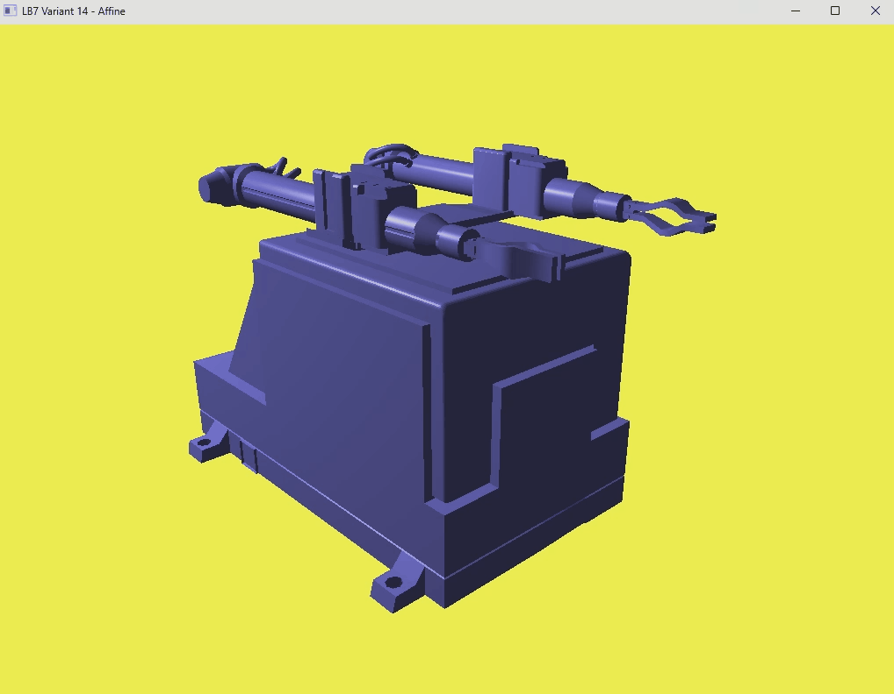

# Лабораторная работа №7
Вариант 14
**Создание движения через аффинные преобразования.**

## Цель

Создать возможность управления моделью с клавиатуры через изменение параметров (угол поворота, смещение) с использованием аффинных преобразований: переноса, поворота и масштабирования. В работе управляется модель промышленного робота «Циклон-5» из ЛБ3.

## Окружение

- Visual Studio, платформа x64
- OpenGL 4.6 Core Profile
- GLFW, GLEW (статическая линковка, `GLEW_STATIC`), GLM, Assimp
- Вариант **14**: цвет фигуры (0.5, 0.5, 1.0), цвет фона (1.0, 1.0, 0.3)

Настройки проекта те же, что в ЛБ5 и ЛБ6 (включая Post-Build Event, копирующий `assimp-vc145-mt.dll` рядом с `.exe`).

## Задание варианта

| Элемент | Движение |
|---|---|
| Базовый элемент | платформа (неподвижна) |
| 1-я степень подвижности | поворот модуля в горизонтальной плоскости |
| 2-я степень подвижности | подъём модуля по вертикали |
| 3-я степень подвижности | линейное движение модуля с захватом |

Дополнительно, по собственной инициативе, реализованы раздельное выдвижение левой и правой руки и смыкание клешней каждой руки.

## Управление

| Клавиши | Действие | Что движется |
|---|---|---|
| **J / L** | поворот влево / вправо (предел ±140°) | станина `Machine_bed` и всё, что на ней |
| **I / K** | подъём вверх / вниз | `Piston_pump` с руками и клешнями |
| **T / G** | левая рука вперёд / назад | `Hand_1` с клешнями |
| **Y / H** | правая рука вперёд / назад | `Hand_2` с клешнями |
| **Z / X** | левая клешня смыкается / размыкается | `Claw_1`, `Claw_2` |
| **C / V** | правая клешня смыкается / размыкается | `Claw_1_1`, `Claw_2_2` |
| **W / A / S / D**, мышь | движение и поворот камеры | камера |
| **F** | режим каркаса | |
| **Esc** | выход | |

## Как устроена программа

### Модель по частям

В ЛБ5 и ЛБ6 модель рисовалась целиком одной матрицей. Теперь каждая деталь рисуется отдельно со своей матрицей. Для этого:

- в класс `Mesh` добавлено поле `name` с именем объекта из файла модели (Assimp берёт его из `.obj`);
- в `Model` добавлена перегрузка `Draw(shader, beforeDraw)`: перед отрисовкой каждой сетки вызывается функция `beforeDraw(имя)`, в которой в основной программе считается матрица `model` этой детали и отправляется в шейдер вместе с `normalMatrix`.

В модели 9 деталей: `Stationary_platform`, `Machine_bed`, `Piston_pump`, `Hand_1`, `Claw_1`, `Claw_2`, `Hand_2`, `Claw_1_1`, `Claw_2_2`.

### Переменные движения

| Переменная | Что хранит | Клавиши |
|---|---|---|
| `baseAngle` | угол поворота станины, градусы | J / L |
| `liftY` | подъём по вертикали, м | I / K |
| `ext1`, `ext2` | выдвижение левой и правой руки, м | T / G, Y / H |
| `clawL`, `clawR` | угол смыкания клешней, градусы | Z / X, C / V |

Значения меняются пропорционально `deltaTime`, поэтому скорость не зависит от FPS, и ограничиваются через `glm::clamp`.

| Параметр | Диапазон |
|---|---|
| `baseAngle` | -140° ... 140° |
| `liftY` | 0 ... 0.45 м |
| `ext1`, `ext2` | 0 ... 0.8 м |
| `clawL`, `clawR` | 0 ... 25° |

### Поворот вокруг произвольной точки

Поворот выполняется вокруг оси, которая не проходит через начало координат. Поэтому используется последовательность: сместить точку в начало координат, повернуть, вернуть обратно:

```cpp
glm::mat4 rotateAround(const glm::vec3& p, float angleDeg, const glm::vec3& axis) {
    glm::mat4 m = glm::mat4(1.0f);
    m = glm::translate(m, p);
    m = glm::rotate(m, glm::radians(angleDeg), axis);
    m = glm::translate(m, -p);
    return m;
}
```

Порядок важен: матрицы умножаются в обратном порядке применения, то есть первым к вершине применяется последний `translate(-p)`.

### Зависимость звеньев

Звенья связаны, поэтому матрица зависимой детали это произведение матриц всех звеньев, от которых она зависит:

| Деталь | Матрица |
|---|---|
| `Stationary_platform` | единичная (неподвижна) |
| `Machine_bed` | `rot` (поворот станины) |
| `Piston_pump` | `rot * lift` |
| `Hand_1`, `Hand_2` | `rot * lift * translate(0, 0, -ext)` |
| `Claw_1`, `Claw_2` | матрица руки `* rotateAround(шарнир клешни, угол, ось X)` |
| `Claw_1_1`, `Claw_2_2` | матрица руки `* rotateAround(шарнир клешни, угол, ось Y)` |

### Точки вращения

Координаты точек найдены по габаритам деталей (`min` / `max` по вершинам, выводятся в консоль при загрузке модели). Система координат программы: Y вверх, «вперёд» (в сторону клешней) это направление -Z. Единицы: метры.

| Что вращается | Точка | Ось |
|---|---|---|
| станина `Machine_bed` | `(0, 0, 0)` | Y |
| `Claw_1` | `(-0.7525, 2.553, -1.19)` | X |
| `Claw_2` | `(-0.7527, 2.425, -1.19)` | X |
| `Claw_1_1` | `(0.682, 2.485, -1.1875)` | Y |
| `Claw_2_2` | `(0.810, 2.4866, -1.1873)` | Y |

### Нормальная матрица

Для каждой детали нормали пересчитываются отдельной матрицей `transpose(inverse(mat3(model)))`, поэтому освещение (модель Фонга из ЛБ6) остаётся корректным при поворотах.

## Результат

Робот управляется с клавиатуры с помощью аффинных преобразований: поворот станины, подъём, раздельное выдвижение рук и смыкание клешней, всё с ограничениями хода. Реализовано коректное освещение сцены.



## Замечания

- Модель экспортирована из Blender в `.obj` с осью Y вверх (по умолчанию). Ограничения (constraints) и анимация Blender в файл не переносятся, всё движение задано в коде.