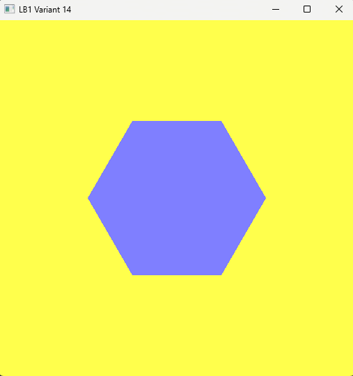
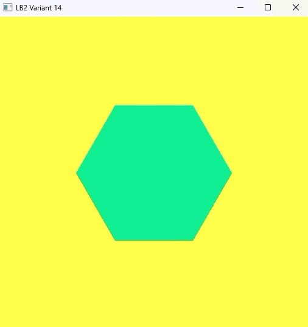
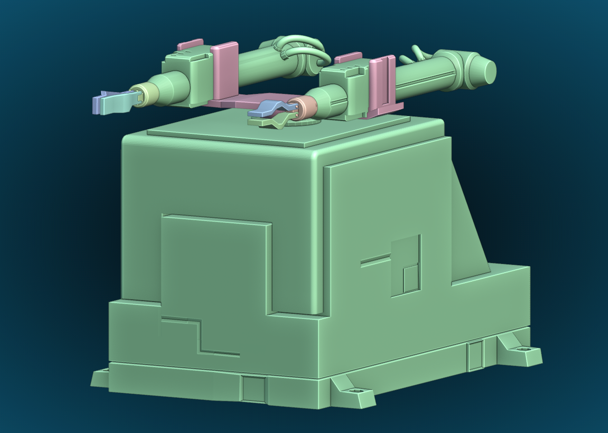
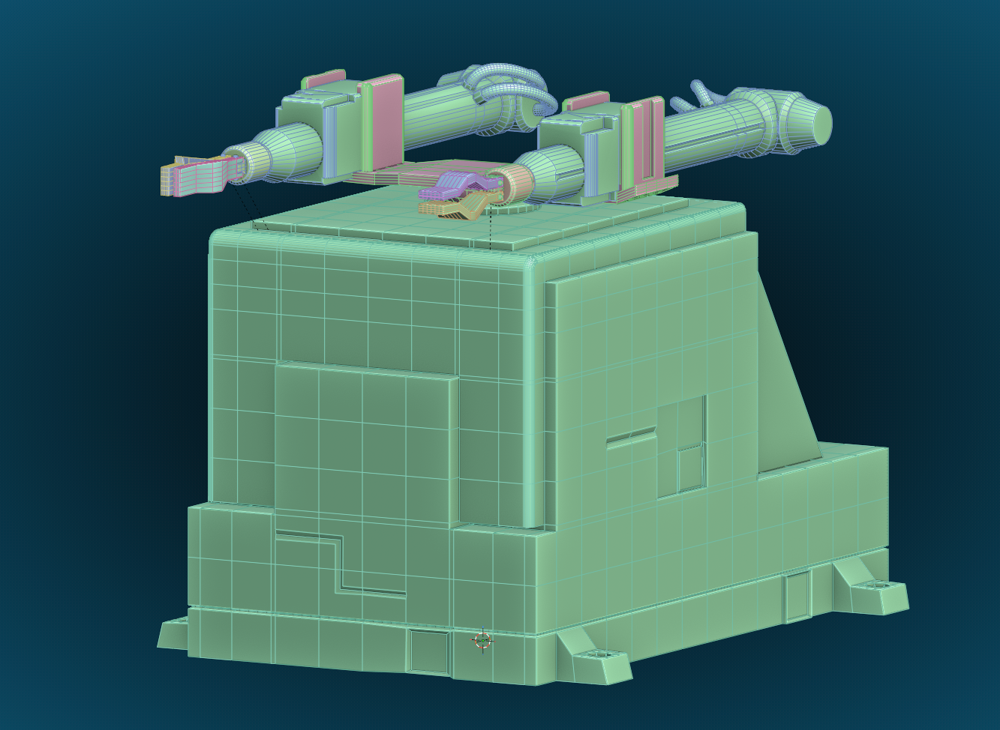
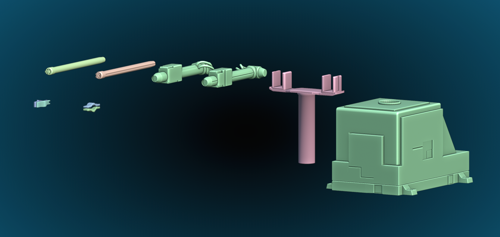
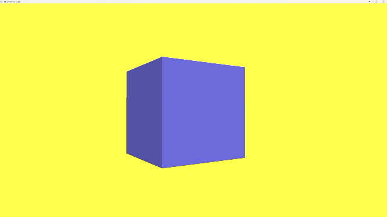
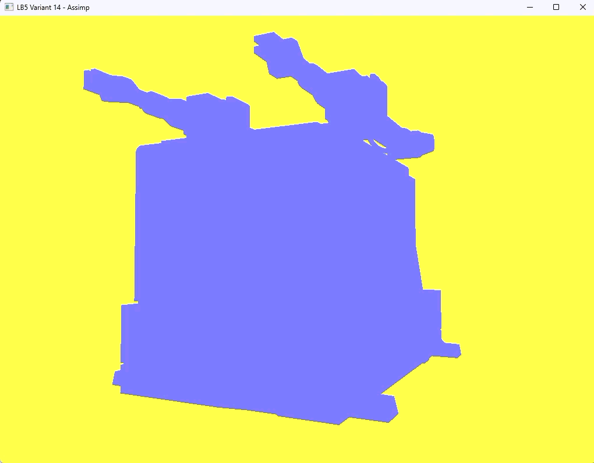
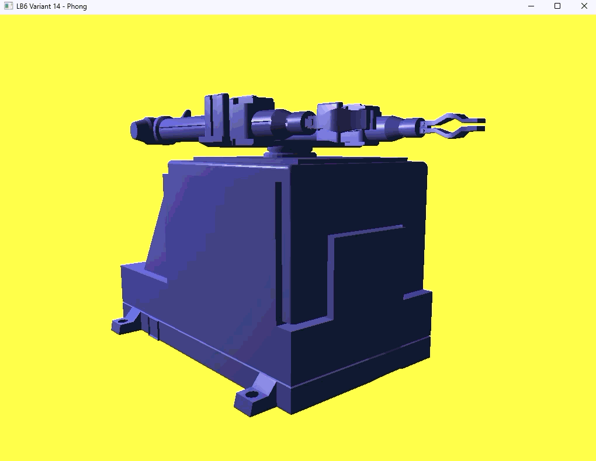
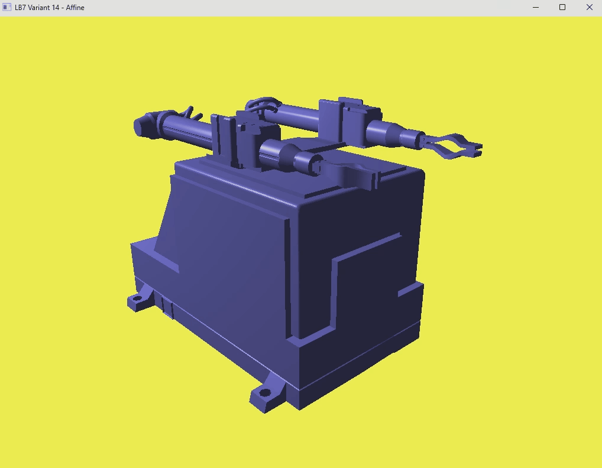

# Computer Graphics Labs OpenGL

Репозиторий с семью лабораторными работами по курсу «Компьютерная графика»: от окна и шестиугольника на OpenGL 1.0 до управляемой трёхмерной модели робота с освещением.

**Вариант:** 14 (шестиугольник, цвет фигуры (0.5, 0.5, 1.0), цвет фона (1.0, 1.0, 0.3))

**Технологии:** Visual Studio (x64), OpenGL 4.6 Core Profile, GLFW, GLEW, GLM, Assimp, Blender.

## Структура репозитория

```
Computer_Graphics_3rd_Year/
├── Gorbenko_A.V_ASUbz_24-1.slnx   решение Visual Studio (все проекты в одном решении)
├── README.md                      общий README (собирается скриптом build-readme.ps1)
├── build-readme.ps1               скрипт сборки общего README из README лабораторных
├── .gitignore
├── glew-2.3.1/                    GLEW (исходники, нужен src/glew.c)
├── glfw-3.5.1.bin.WIN64/          GLFW (готовые бинарники для Windows)
├── glm-X.Y.Z/                     GLM (только заголовочные файлы)
├── Assimp/                        Assimp (include, lib/x64, bin/x64)
├── LB1/ … LB7/                    проекты лабораторных работ
└── Assets/
    └── Blender_model_Cyclone-5/   модель робота: .blend, .obj, .mtl, png/, README.md
```

Библиотеки лежат в корне репозитория один раз и подключаются ко всем проектам через `$(SolutionDir)`, поэтому проекты собираются без установки чего-либо в систему.

## Состав проектов

| Проект | Основные файлы | Что делает |
|---|---|---|
| **LB1** | `LB1.cpp` | окно и контекст, шестиугольник на OpenGL 1.0 (`glBegin` / `glEnd`) |
| **LB2** | `LB2.cpp`, `Shader.h`, `shaders/` | VAO, VBO, EBO, шейдеры, `uniform`, класс `Shader` |
| **Assets** (ЛБ3) | `Cyclone-5.blend`, `cyclone-5.obj`, `Cyclone-5.mtl`, `png/` | 3D-модель робота «Циклон-5» в Blender, экспорт в `.obj` |
| **LB4** | `LB4.cpp`, `Shader.h`, `shaders/` | камера (WASD, мышь), матрицы, библиотека GLM |
| **LB5** | `LB5.cpp`, `Mesh.h`, `Model.h`, `Shader.h`, `shaders/` | импорт модели через Assimp, классы `Mesh` и `Model`, плоская заливка |
| **LB6** | `LB6.cpp`, `Mesh.h`, `Model.h`, `Shader.h`, `shaders/` | освещение по модели Фонга: ambient, diffuse, specular |
| **LB7** | `LB7.cpp`, `Mesh.h`, `Model.h`, `Shader.h`, `shaders/` | управление звеньями робота с клавиатуры: матрицы для каждой детали |

## Как собрать и запустить

1. `git clone https://github.com/IONA-G/Computer_Graphics_3rd_Year.git`
2. Открыть решение `Gorbenko_A.V_ASUbz_24-1.slnx` в Visual Studio.
3. Выбрать платформу **x64**, нужный проект сделать запускаемым (ПКМ, Set as Startup Project).
4. Собрать и запустить (Ctrl+F5).

## Содержание

- [Лабораторная работа №1](#lb1)
- [Лабораторная работа №2](#lb2)
- [Лабораторная работа №3](#lb3)
- [Лабораторная работа №4](#lb4)
- [Лабораторная работа №5](#lb5)
- [Лабораторная работа №6](#lb6)
- [Лабораторная работа №7](#lb7)

<a id="lb1"></a>

# Лабораторная работа №1. OpenGL: окно, контекст, первая фигура

Вариант **14**: шестиугольник.

| Параметр | Значение (r, g, b) |
|---|---|
| Цвет фигуры | (0.5, 0.5, 1.0) |
| Цвет фона | (1.0, 1.0, 0.3) |

## Задание

Подготовить проект в Visual Studio для работы с OpenGL, создать окно с графическим контекстом и вывести на экран фигуру своего варианта. В работе используется классический режим OpenGL 1.0 (`glBegin` / `glEnd`).

## Окружение

- Visual Studio, сборка Debug x64
- GLFW 3.5.1: создание окна, контекста и обработка событий
- GLEW 2.3.1: загрузка функций OpenGL
- Оба проекта подключены статически: `glfw3.lib` в зависимостях линкера, `glew.c` добавлен прямо в проект, в настройках задан макрос `GLEW_STATIC`

## Как устроена программа

1. **Запуск GLFW.** Проверяется результат `glfwInit()`, при ошибке программа завершается.
2. **Версия OpenGL.** Через `glfwWindowHint` запрашивается версия 1.0, строки с `FORWARD_COMPAT` и `CORE_PROFILE` оставлены закомментированными, иначе `glBegin` работать не будет.
3. **Окно и контекст.** Окно 512 × 512 создаётся через `glfwCreateWindow`, контекст делается текущим функцией `glfwMakeContextCurrent`.
4. **Запуск GLEW.** `glewInit()` вызывается после создания контекста, результат проверяется.
5. **Вывод информации.** В консоль печатаются версия GLEW, версия OpenGL и название видеокарты.
6. **Главный цикл** работает, пока окно не закрыто. На каждом кадре порядок такой: задать цвет фона и очистить кадр, нарисовать фигуру, поменять буферы (`glfwSwapBuffers`), обработать события (`glfwPollEvents`).
7. **Завершение.** После выхода из цикла вызывается `glfwTerminate()`.

## Как строится шестиугольник

Окно использует стандартные координаты OpenGL: от −1 до 1 по обеим осям, центр в точке (0, 0). Шестиугольник вписан в окружность радиуса `R = 0.5`. Вершины лежат на ней через каждые 60° (π/3):

```
x = R · cos(a),   y = R · sin(a),   a = i · π/3,   i = 0…5
```

Фигура собрана из шести треугольников, у которых общая вершина в центре. Треугольник номер `i` образован центром и двумя соседними вершинами на окружности (с углами `i·π/3` и `(i+1)·π/3`). Рисуются они в режиме `GL_TRIANGLES`, цвет задаётся один раз функцией `glColor3f` перед вершинами.

## Результат

В окне отображается сиреневый шестиугольник на жёлтом фоне.



## Замечания
- Макросы `GLEW_DLL` и `GLFW_DLL` не используются, так как библиотеки подключены статически.

---

<a id="lb2"></a>

# Лабораторная работа №2. Современный OpenGL 4.6: VAO, VBO, EBO и шейдеры

Вариант **14**: шестиугольник.

## Цель

Перейти от классического рендера на `glBegin` / `glEnd` к современному OpenGL: хранить геометрию в буферах видеокарты (VBO, EBO), описывать формат вершин в VAO и выводить фигуру через шейдерную программу. Добавить анимацию фигуры во времени и написать собственную библиотеку для работы с шейдерами.

## Основные идеи

В первой лабораторной вершины отправлялись на видеокарту по одной в момент рисования. Здесь все данные загружаются в видеопамять один раз:

- **VBO** хранит координаты вершин;
- **EBO** хранит индексы, по которым из этих вершин собираются треугольники, поэтому общие вершины не дублируются;
- **VAO** запоминает, как читать данные из буфера, и позволяет перед рисованием подключить всё одним вызовом;
- **шейдеры** на языке GLSL заменяют фиксированный конвейер: вершинный шейдер отвечает за позицию, фрагментный за цвет пикселей.

Для запроса Core Profile включены `GLFW_OPENGL_FORWARD_COMPAT` (`GL_TRUE`) и `GLFW_OPENGL_CORE_PROFILE`. Из-за этого `glBegin` и `glEnd` в программе больше не работают.

## Окружение

- Visual Studio, сборка Debug x64
- OpenGL 4.6 Core Profile 
- GLFW 3.5.1 и GLEW 2.3.1, оба подключены статически
- GLSL `#version 410 core`

## Геометрия шестиугольника

Шестиугольник вписан в окружность радиуса 0.5. Вершин **7**: центр и шесть точек по окружности. Из них собираются **6 треугольников**, у каждого общая вершина в центре. Поэтому индексов **18** (6 × 3), и отрисовка выглядит так:

```cpp
glDrawElements(GL_TRIANGLES, 18, GL_UNSIGNED_INT, 0);
```

| Индекс | Координаты (x, y) |
|---|---|
| 0 | (0, 0): центр |
| 1 | (0.5, 0) |
| 2 | (0.25, 0.433) |
| 3 | (−0.25, 0.433) |
| 4 | (−0.5, 0) |
| 5 | (−0.25, −0.433) |
| 6 | (0.25, −0.433) |

Индексы треугольников: `0 1 2`, `0 2 3`, `0 3 4`, `0 4 5`, `0 5 6`, `0 6 1`.

## Задание 1. Цвет, зависящий от времени

Цвет фигуры передаётся во фрагментный шейдер через `uniform vec4 ourColor`. Каждый кадр на CPU вычисляется новое значение по времени работы программы `t = glfwGetTime()`:

```cpp
r = sin(t)        * 0.5 + 0.5;
g = sin(t + 2.0)  * 0.5 + 0.5;
b = sin(t + 4.0)  * 0.5 + 0.5;
```

`sin` возвращает значения от −1 до 1, поэтому результат приводится к диапазону 0…1 (`* 0.5 + 0.5`). У каждого канала свой сдвиг фазы, поэтому цвет не просто «мигает», а плавно проходит через разные оттенки. Период цикла около 6,3 секунды.

## Задание 2. Своя библиотека для шейдеров (`Shader.h`)

Текст шейдеров вынесен из кода в файлы `shaders/shader.vert` и `shaders/shader.frag`. Класс `Shader`:

- читает файлы шейдеров (с удалением BOM, если редактор его добавил);
- компилирует вершинный и фрагментный шейдеры и проверяет результат через `glGetShaderiv` и `glGetShaderInfoLog`;
- линкует программу и проверяет результат через `glGetProgramiv` и `glGetProgramInfoLog`;
- имеет методы `use()` и `remove()`;
- передаёт `uniform` одной строкой:

```cpp
Shader shader("shaders/shader.vert", "shaders/shader.frag");
...
shader.use();
shader.setVec4("ourColor", r, g, b, 1.0f);
```

Реализованы методы: `setBool`, `setInt`, `setFloat`, `setVec2`, `setVec3`, `setVec4`, `setMat4`.

### Варианты передачи uniform по количеству элементов и типу

| Функция OpenGL | Что передаёт | Тип в GLSL |
|---|---|---|
| `glUniform1f` / `2f` / `3f` / `4f` | 1–4 числа `float` | `float`, `vec2`, `vec3`, `vec4` |
| `glUniform1i` / `2i` / `3i` / `4i` | 1–4 числа `int` | `int`, `ivec2`…, `bool`, `sampler2D` |
| `glUniform1ui` / `2ui` / `3ui` / `4ui` | 1–4 числа `unsigned int` | `uint`, `uvec2`… |
| `glUniform1fv` / `2fv` / `3fv` / `4fv` | массив значений `float` | массивы и `vecN` |
| `glUniformMatrix2fv` / `3fv` / `4fv` | матрица | `mat2`, `mat3`, `mat4` |

## Структура

```
LB2/
├── LB2.cpp            основная программа
├── Shader.h           библиотека для работы с шейдерами
└── shaders/
    ├── shader.vert    вершинный шейдер
    └── shader.frag    фрагментный шейдер
```

## Результат

На жёлтом фоне `(1.0, 1.0, 0.3)` отображается шестиугольник, цвет которого плавно переливается со временем.



---

<a id="lb3"></a>

# Лабораторная работа №3: Создание 3D-модели в Blender

Расположение модели: `Assets/Blender_model_Cyclone-5/`
* `Cyclone-5.blend` — исходник Blender (Blender 5.2 LTS).
* `C5_1.png`, `C5_2.png`, `C5_3.png` — изображения модели для README.

## Цель
Создать в Blender 3D-модель промышленного робота по варианту (Циклон-5) с сохранением дробления по типу и группе движения для первых трёх степеней подвижности.

## Основные идеи
Передать общую форму конструкции по референсу и правильно разделить её на подвижные части. Эта структура будет основой для последующего импорта модели в OpenGL, настройки текстур и освещения и реализации движения в следующих лабораторных работах.

Единицы сцены: метрическая система, отображение в сантиметрах (1 единица Blender = 1 м, значения в панелях показываются в см).

## Реализовано
* Создана 3D-модель промышленного робота-манипулятора «Циклон-5».
* Подвижные элементы разделены на отдельные объекты по трём степеням подвижности.
* Построена иерархия родитель – потомок (parenting): дочерние части наследуют движение родителя.
* Для каждой степени подвижности заданы ограничения трансформаций (constraints).
* Все объекты названы латиницей, чтобы модель было удобнее импортировать в код.
* **Дополнительно:** смоделированы клешни-захваты на концах рук, у которых настроено раскрытие и закрытие.

## Соответствие заданию варианта

| Степень подвижности | Движение по варианту | Объект в модели |
|---|---|---|
| Базовый элемент | Платформа (неподвижна) | `Stationary_platform` |
| 1-я | Поворот модуля в горизонтальной плоскости | `Machine_bed` |
| 2-я | Подъём модуля по вертикали | `Piston_pump` |
| 3-я | Линейное движение модуля с захватом | `Hand_1`, `Hand_2` |
| Дополнительно | Раскрытие и закрытие захвата | `Claw_1`, `Claw_2`, `Claw_1_1`, `Claw_2_2` |

## Структура модели и иерархия

Коллекции сцены: `Scene Collection` (содержит `Machine_bed` и `Piston_pump`), `Collection` (`Stationary_platform`), `Left_hand` и `Right_hand`.

Иерархия объектов (родитель → потомки):

```
Stationary_platform
└── Machine_bed
    └── Piston_pump
        ├── Hand_1
        │   ├── Claw_1
        │   └── Claw_2
        └── Hand_2
            ├── Claw_1_1
            └── Claw_2_2
```

## Особенности реализации (цепочка ограничений)
Ограничения заданы через Blender Constraints. Все ограничения заданы в локальном пространстве объекта (`Local Space`), и в каждом включена опция `Affect Transform`, чтобы значения не выходили за заданные пределы при ручном перемещении и вращении.

* **База (`Stationary_platform`):**
  * Точка отсчёта, ограничений нет, остаётся неподвижной.
* **1-я степень (`Machine_bed`, поворот):**
  * `Limit Rotation`: поворот только вокруг локальной оси Z в пределах от −90° до 90°. По осям X и Y поворот заблокирован.
* **2-я степень (`Piston_pump`, подъём):**
  * `Limit Location`: перемещение только по локальной оси Z в пределах от 0 до 25 см. По осям X и Y перемещение заблокировано.
* **3-я степень (`Hand_1` и `Hand_2`, выдвижение):**
  * `Limit Location`: перемещение по локальной оси Y в пределах от 0 до 150 см.
  * *Примечание:* длина хода рук увеличена до **150 см** (на чертеже ход руки 60 см) для наглядности демонстрации выдвижения.
* **Дополнительно (клешни-захваты):**
  * Левая рука: `Claw_1` — `Limit Rotation` по локальной оси X от 0° до 20°, `Claw_2` — от −20° до 0°.
  * Правая рука: `Claw_1_1` — `Limit Rotation` по локальной оси Z от 0° до 20°, `Claw_2_2` — от −20° до 0°.
  * У половинок в паре заданы противоположные значения, поэтому они раскрываются и закрываются навстречу друг другу.

## Замечания
* Ограничения Blender действуют только внутри Blender и при экспорте модели в другие форматы не переносятся, поэтому пределы движения нужно будет задавать в коде следующих лабораторных работ.
* Клешни не входят в первые три степени подвижности и добавлены по собственной инициативе.

## Результат
Подготовлена 3D-модель робота Циклон-5, разбитая на подвижные части, с настроенной цепочкой ограничений и иерархией.

## Визуализация

**Общий вид**


**Сетка**


**Детали модели**


---

<a id="lb4"></a>

# Лабораторная работа №4. Камера и матрицы: библиотека glm

Реализовать управление камерой в 3D-сцене с использованием матриц и библиотеки GLM.

## Задача

Превратить плоскую сцену из предыдущих работ в трёхмерную: добавить матрицы проекции и вида, подключить библиотеку **GLM** и сделать камеру, которой можно управлять с клавиатуры и мыши. Для демонстрации выводится куб.

## Окружение

- Visual Studio, сборка Debug x64
- OpenGL 4.6 Core Profile, GLSL `#version 410 core`
- GLFW 3.5.1 и GLEW 2.3.1 (статическое подключение)
- GLM: библиотека только из заголовочных файлов, подключена через Additional Include Directories
- Класс `Shader` из лабораторной работы №2 (загрузка шейдеров из файлов и передача `uniform`)

## Структура

```
LB4/
├── LB4.cpp            основная программа: камера, ввод, куб
├── Shader.h           загрузка шейдеров и передача uniform
└── Shader/
    ├── shader.vert    вершинный шейдер (матрицы)
    └── shader.frag    фрагментный шейдер (цвет)
```

## Путь вершины на экран

Вершины куба заданы в локальных координатах (от −0,5 до 0,5). Вершинный шейдер переводит их на экран четырьмя матрицами:

```glsl
gl_Position = projection * view * model * transform * vec4(aPos, 1.0);
```

Матрицы применяются справа налево:

| Матрица | Что делает | Как задана |
|---|---|---|
| `transform` | фиксированный поворот куба | `glm::rotate`, 30° вокруг оси Y |
| `model` | положение объекта в мире | единичная матрица (куб в начале координат) |
| `view` | положение и направление камеры | `glm::lookAt(cameraPos, cameraPos + cameraFront, cameraUp)` |
| `projection` | перспектива | `glm::perspective(45°, ширина/высота, 0.1, 100)` |

Соотношение сторон для `projection` считается каждый кадр по размеру окна, поэтому при изменении размера куб не растягивается. Матрицы передаются в шейдер через `shader.setMat4(...)` и `glm::value_ptr(...)`.

## Камера

Камера задаётся тремя векторами:

| Переменная | Начальное значение | Смысл |
|---|---|---|
| `cameraPos` | (0, 0, 3) | положение камеры (точка) |
| `cameraFront` | (0, 0, −1) | направление взгляда (вектор) |
| `cameraUp` | (0, 1, 0) | направление «вверх» |

Точка, на которую смотрит камера, считается как `cameraPos + cameraFront`, поэтому взгляд не привязан к началу координат и следует за камерой.

## Управление

| Действие | Клавиши и мышь |
|---|---|
| Движение вперёд и назад | `W` / `S` |
| Движение влево и вправо | `A` / `D` |
| Поворот взгляда | движение мыши |
| Режим каркаса вкл/выкл | `F` |
| Выход | `Esc` |

Курсор скрыт и закреплён внутри окна (`GLFW_CURSOR_DISABLED`).

### Движение

`W` и `S` смещают камеру вдоль `cameraFront`. Для `A` и `D` берётся вектор «вправо» как нормализованное векторное произведение `cross(cameraFront, cameraUp)`. Шаг равен `2.5 * deltaTime`, где `deltaTime` это время последнего кадра, поэтому скорость (2,5 единицы в секунду) не зависит от частоты кадров.

### Поворот мышью

В обработчике движения мыши смещение курсора с прошлого события умножается на чувствительность 0,1 и добавляется к углам `yaw` (рыскание) и `pitch` (тангаж). Угол `pitch` ограничен диапазоном от −89° до 89°: при 90° вектор взгляда совпал бы с вектором «вверх», и `lookAt` переворачивался бы. Из углов вычисляется направление взгляда:

```
x = cos(yaw) · cos(pitch)
y = sin(pitch)
z = sin(yaw) · cos(pitch)
```

Начальное значение `yaw = −90°` даёт `cameraFront = (0, 0, −1)`, то есть камера сразу смотрит на куб. Флаг `firstMouse` убирает резкий скачок камеры при первом движении мыши.

## Куб

- В буфере **24 вершины** (6 граней по 4): у каждой грани свой оттенок, поэтому одну и ту же угловую точку приходится описывать отдельно для каждой из трёх граней.
- **36 индексов** в EBO (6 граней × 2 треугольника × 3 вершины), отрисовка `glDrawElements(GL_TRIANGLES, 36, ...)`.
- Цвет грани это цвет варианта (0.5, 0.5, 1.0), умноженный на коэффициент яркости грани. Так при одном цвете куб не выглядит плоским силуэтом, хотя освещения пока нет.
- Включён **тест глубины** (`GL_DEPTH_TEST`), буфер глубины очищается вместе с цветом каждый кадр. Без него ближние и дальние грани перекрывали бы друг друга в порядке рисования.

## Способы задания ориентации 

| Способ | Идея | Использован |
|---|---|---|
| Look-At | ориентация по точке, на которую смотрит камера | да, построение матрицы `view` |
| Углы Эйлера | три угла (yaw, pitch, roll) | да, yaw и pitch для мыши |
| Кватернионы | вращение без блокировки осей и с плавной интерполяцией | нет |

Крен (`roll`) не используется. Ограничение угла `pitch` защищает от вырождения `lookAt`, которое возникает при взгляде вертикально вверх или вниз.

## Отличия от методических указаний

- Библиотека **glad** не подключалась: функции OpenGL загружает GLEW, который уже использовался в предыдущих работах.
- Начальное значение `yaw` задано равным −90°, иначе камера сразу смотрела бы вправо.
- Скорость камеры привязана ко времени кадра (`deltaTime`), а не к фиксированному шагу на кадр.
- Переключение каркаса и выход обрабатываются через `glfwSetKeyCallback` (срабатывает один раз при нажатии), движение через опрос `glfwGetKey` (каждый кадр).

## Результат

Реализована 3D-навигация по сцене: куб отображается в перспективе, камера свободно перемещается и поворачивается, режим каркаса показывает рёбра и треугольники.



---

<a id="lb5"></a>

# Лабораторная работа №5

**Подключение и работа с библиотекой ASSIMP. Настройка импорта модели.**

## Цель

Подключить библиотеку ASSIMP и написать фрагмент программы для импорта модели в формате `.obj` с возможностью дальнейшей работы с ней: отрисовать собственную модель робота «Циклон-5», экспортированную из Blender.

## Окружение

- Visual Studio, платформа x64
- OpenGL 4.6 Core Profile
- GLFW, GLEW (статическая линковка, `GLEW_STATIC`), GLM
- Assimp (в репозиторий скопированы `include`, `lib\x64` и `bin\x64`)
- Вариант **14**: цвет фигуры (0.5, 0.5, 1.0), цвет фона (1.0, 1.0, 0.3)

### Подключение Assimp в свойствах проекта

| Где | Значение |
|---|---|
| C/C++ → General → Additional Include Directories | `$(SolutionDir)Assimp\include` |
| Linker → General → Additional Library Directories | `$(SolutionDir)Assimp\lib\x64` |
| Linker → Input → Additional Dependencies | `assimp-vc145-mt.lib` |
| Debugging → Working Directory | `$(ProjectDir)` |
| Build Events → Post-Build Event → Command Line | `xcopy /y /d "$(SolutionDir)Assimp\bin\x64\assimp-vc145-mt.dll" "$(OutDir)"` |


## Как устроена программа

Модель загружается через Assimp в объект сцены `aiScene`. Данные из сцены переносятся в собственные классы, которые готовят геометрию к отрисовке в OpenGL.

```
Scene → Node → Mesh → Face / Vertex
```

| Файл | Назначение |
|---|---|
| `LB5.cpp` | окно и контекст OpenGL 4.6 Core, камера из ЛР4, главный цикл, передача матриц и цвета в шейдер |
| `Mesh.h` | структура `Vertex` (позиция и нормаль) и класс `Mesh`: настройка VAO / VBO / EBO, отрисовка `glDrawElements` |
| `Model.h` | класс `Model`: `loadModel` (чтение файла через `Assimp::Importer::ReadFile`), `processNode` (рекурсивный обход узлов), `processMesh` (извлечение вершин, нормалей и индексов) |
| `Shader.h` | класс `Shader` из предыдущих лабораторных |
| `shaders/model.vert` | вершинный шейдер: `projection * view * model * vec4(aPos, 1.0)` |
| `shaders/model.frag` | фрагментный шейдер: плоская заливка цветом `uniform vec3 lightColor` |

Порядок загрузки:

1. `Importer::ReadFile` читает `.obj` с флагами `aiProcess_Triangulate` и `aiProcess_GenSmoothNormals`.
2. `processNode` рекурсивно обходит узлы, начиная с корневого `mRootNode`.
3. `processMesh` копирует позиции, нормали и индексы граней в `std::vector<Vertex>` и `std::vector<unsigned int>`.
4. Из этих данных создаётся объект `Mesh`, который отправляет их в видеопамять.
5. В главном цикле `Model::Draw` отрисовывает все сетки по очереди.

Путь к модели задаётся относительно папки проекта:

```cpp
Model robot("../Assets/Blender_model_Cyclone-5/cyclone-5.obj");
```

## Управление

- **W / A / S / D**: перемещение камеры
- **Мышь**: поворот камеры
- **F**: переключение режима каркаса
- **Esc**: выход

## Результат

Модель в формате `.obj` загружается, разбирается на меши и отображается в сцене OpenGL.

Сплошная заливка цветом и сетка




## Замечания

- Для проверки импорта используется плоская заливка одним цветом через `uniform vec3 lightColor`. Без передачи этого значения модель закрашивается чёрным.
- Нормали вершин уже загружаются и передаются в шейдер (`location = 1`), но пока не используются. Это основа для освещения в следующих работах.
- Экспорт из Blender: `File → Export → Wavefront (.obj)`, оси Forward `-Z` и Up `Y` (по умолчанию), включены Apply Modifiers и Triangulated Mesh. Констрейнты и анимация в `.obj` не переносятся, в файл попадает статичная модель.
- Установленная версия Assimp содержит только Release-библиотеку `assimp-vc145-mt.lib`.

---

<a id="lb6"></a>

# Лабораторная работа №6

**Настройка освещения с использованием шейдерных программ.**

## Цель

Освоить принципы настройки освещения в OpenGL с использованием шейдеров, включая моделирование окружающего, диффузного и зеркального света на основе модели Фонга. Применить освещение к модели робота «Циклон-5», импортированной через Assimp.

## Окружение

- Visual Studio, платформа x64
- OpenGL 4.6 Core Profile
- GLFW, GLEW (статическая линковка, `GLEW_STATIC`), GLM, Assimp
- Вариант **14**: цвет фигуры (0.5, 0.5, 1.0), цвет фона (1.0, 1.0, 0.3)

Настройки проекта те же, что в ЛБ5:

| Где | Значение |
|---|---|
| C/C++ → General → Additional Include Directories | пути `include` для GLEW, GLFW, GLM и `$(SolutionDir)Assimp\include` |
| C/C++ → Preprocessor → Preprocessor Definitions | `GLEW_STATIC` |
| Linker → General → Additional Library Directories | `$(SolutionDir)glfw-3.5.1.bin.WIN64\lib-vc2026`, `$(SolutionDir)Assimp\lib\x64` |
| Linker → Input → Additional Dependencies | `glfw3.lib;glfw3dll.lib;opengl32.lib;User32.lib;GDI32.lib;Shell32.lib;assimp-vc145-mt.lib` |
| Debugging → Working Directory | `$(ProjectDir)` |
| Build Events → Post-Build Event → Command Line | `xcopy /y /d "$(SolutionDir)Assimp\bin\x64\assimp-vc145-mt.dll" "$(OutDir)"` |

## Как устроена программа

Освещение считается по модели Фонга. Она состоит из трёх компонентов, итоговый цвет точки это их сумма:

| Компонент | Формула | Что даёт |
|---|---|---|
| Окружающий (ambient) | `LightColor * MaterialAmbient` | базовый свет, не даёт теням стать полностью чёрными |
| Диффузный (diffuse) | `LightColor * MaterialDiffuse * max(dot(N, L), 0)` | яркость зависит от угла падения света на поверхность |
| Зеркальный (specular) | `LightColor * MaterialSpecular * pow(max(dot(R, V), 0), Shininess)` | блики на глянцевых поверхностях |

Здесь `N` — нормаль к поверхности, `L` — направление на источник света, `R` — отражённый луч, `V` — направление на камеру.

### Файлы проекта

| Файл | Назначение |
|---|---|
| `LB6.cpp` | окно и контекст OpenGL 4.6 Core, камера из ЛР4, расчёт `normalMatrix`, передача параметров света, материала и положения камеры в шейдер |
| `Mesh.h`, `Model.h` | загрузка модели через Assimp и отрисовка (без изменений по сравнению с ЛБ5, нормали вершин уже передаются в шейдер) |
| `Shader.h` | класс `Shader`; добавлены методы `setMat3` и перегрузка `setVec3` для `glm::vec3` |
| `shaders/model.vert` | вершинный шейдер: передаёт во фрагментный `FragPos` (положение точки в мире) и `Normal` (нормаль через `normalMatrix`) |
| `shaders/model.frag` | фрагментный шейдер: структуры `Material` и `Light`, расчёт трёх компонентов освещения |

### Нормальная матрица

Если умножать нормаль просто на матрицу модели, при неравномерном масштабировании она перестаёт быть перпендикулярной поверхности. Поэтому нормали преобразуются отдельной матрицей:

```cpp
glm::mat3 normalMatrix = glm::transpose(glm::inverse(glm::mat3(model)));
```

В вершинном шейдере: `Normal = normalMatrix * aNormal;`

### Параметры света и материала

Свет и материал описаны структурами в фрагментном шейдере, значения задаются из `LB6.cpp`:

| Параметр | Значение |
|---|---|
| `light.position` | `(3.0, 4.0, 3.0)` |
| `light.ambient` | `(0.2, 0.2, 0.2)`, слабый фоновый свет |
| `light.diffuse` | `(0.8, 0.8, 0.8)`, основной белый свет |
| `light.specular` | `(1.0, 1.0, 1.0)`, блики с полной силой |
| `material.ambient` и `material.diffuse` | `(0.5, 0.5, 1.0)`, цвет фигуры варианта 14 |
| `material.specular` | `(0.5, 0.5, 0.5)` |
| `material.shininess` | `32.0`, резкость блика |

Положение камеры (`viewPos`) передаётся в шейдер каждый кадр и нужно для расчёта бликов.

## Управление

- **W / A / S / D**: перемещение камеры
- **Мышь**: поворот камеры
- **F**: переключение режима каркаса
- **Esc**: выход

## Результат

Модель отображается с освещением по Фонгу: видны фоновая подсветка тёмных сторон, плавный градиент диффузного света и блики на кромках и цилиндрах.



## Замечания

- Нормали вершин берутся из файла модели через Assimp. Если в `.obj` их нет, они создаются автоматически флагом `aiProcess_GenSmoothNormals`.
- Все расчёты освещения выполняются во фрагментном шейдере (по пикселям), поэтому блики получаются гладкими.
- Положение света и интенсивности подбирались под размер модели; при другом масштабе модели `lightPos` нужно изменить.

---

<a id="lb7"></a>

# Лабораторная работа №7
Вариант 14
**Создание движения через аффинные преобразования.**

## Цель

Создать возможность управления моделью с клавиатуры через изменение параметров (угол поворота, смещение) с использованием аффинных преобразований: переноса, поворота и масштабирования. В работе управляется модель промышленного робота «Циклон-5» из ЛБ3.

## Окружение

- Visual Studio, платформа x64
- OpenGL 4.6 Core Profile
- GLFW, GLEW (статическая линковка, `GLEW_STATIC`), GLM, Assimp
- Вариант **14**: цвет фигуры (0.5, 0.5, 1.0), цвет фона (1.0, 1.0, 0.3)

Настройки проекта те же, что в ЛБ5 и ЛБ6 (включая Post-Build Event, копирующий `assimp-vc145-mt.dll` рядом с `.exe`).

## Задание варианта

| Элемент | Движение |
|---|---|
| Базовый элемент | платформа (неподвижна) |
| 1-я степень подвижности | поворот модуля в горизонтальной плоскости |
| 2-я степень подвижности | подъём модуля по вертикали |
| 3-я степень подвижности | линейное движение модуля с захватом |

Дополнительно, по собственной инициативе, реализованы раздельное выдвижение левой и правой руки и смыкание клешней каждой руки.

## Управление

| Клавиши | Действие | Что движется |
|---|---|---|
| **J / L** | поворот влево / вправо (предел ±140°) | станина `Machine_bed` и всё, что на ней |
| **I / K** | подъём вверх / вниз | `Piston_pump` с руками и клешнями |
| **T / G** | левая рука вперёд / назад | `Hand_1` с клешнями |
| **Y / H** | правая рука вперёд / назад | `Hand_2` с клешнями |
| **Z / X** | левая клешня смыкается / размыкается | `Claw_1`, `Claw_2` |
| **C / V** | правая клешня смыкается / размыкается | `Claw_1_1`, `Claw_2_2` |
| **W / A / S / D**, мышь | движение и поворот камеры | камера |
| **F** | режим каркаса | |
| **Esc** | выход | |

## Как устроена программа

### Модель по частям

В ЛБ5 и ЛБ6 модель рисовалась целиком одной матрицей. Теперь каждая деталь рисуется отдельно со своей матрицей. Для этого:

- в класс `Mesh` добавлено поле `name` с именем объекта из файла модели (Assimp берёт его из `.obj`);
- в `Model` добавлена перегрузка `Draw(shader, beforeDraw)`: перед отрисовкой каждой сетки вызывается функция `beforeDraw(имя)`, в которой в основной программе считается матрица `model` этой детали и отправляется в шейдер вместе с `normalMatrix`.

В модели 9 деталей: `Stationary_platform`, `Machine_bed`, `Piston_pump`, `Hand_1`, `Claw_1`, `Claw_2`, `Hand_2`, `Claw_1_1`, `Claw_2_2`.

### Переменные движения

| Переменная | Что хранит | Клавиши |
|---|---|---|
| `baseAngle` | угол поворота станины, градусы | J / L |
| `liftY` | подъём по вертикали, м | I / K |
| `ext1`, `ext2` | выдвижение левой и правой руки, м | T / G, Y / H |
| `clawL`, `clawR` | угол смыкания клешней, градусы | Z / X, C / V |

Значения меняются пропорционально `deltaTime`, поэтому скорость не зависит от FPS, и ограничиваются через `glm::clamp`.

| Параметр | Диапазон |
|---|---|
| `baseAngle` | -140° ... 140° |
| `liftY` | 0 ... 0.45 м |
| `ext1`, `ext2` | 0 ... 0.8 м |
| `clawL`, `clawR` | 0 ... 25° |

### Поворот вокруг произвольной точки

Поворот выполняется вокруг оси, которая не проходит через начало координат. Поэтому используется последовательность: сместить точку в начало координат, повернуть, вернуть обратно:

```cpp
glm::mat4 rotateAround(const glm::vec3& p, float angleDeg, const glm::vec3& axis) {
    glm::mat4 m = glm::mat4(1.0f);
    m = glm::translate(m, p);
    m = glm::rotate(m, glm::radians(angleDeg), axis);
    m = glm::translate(m, -p);
    return m;
}
```

Порядок важен: матрицы умножаются в обратном порядке применения, то есть первым к вершине применяется последний `translate(-p)`.

### Зависимость звеньев

Звенья связаны, поэтому матрица зависимой детали это произведение матриц всех звеньев, от которых она зависит:

| Деталь | Матрица |
|---|---|
| `Stationary_platform` | единичная (неподвижна) |
| `Machine_bed` | `rot` (поворот станины) |
| `Piston_pump` | `rot * lift` |
| `Hand_1`, `Hand_2` | `rot * lift * translate(0, 0, -ext)` |
| `Claw_1`, `Claw_2` | матрица руки `* rotateAround(шарнир клешни, угол, ось X)` |
| `Claw_1_1`, `Claw_2_2` | матрица руки `* rotateAround(шарнир клешни, угол, ось Y)` |

### Точки вращения

Координаты точек найдены по габаритам деталей (`min` / `max` по вершинам, выводятся в консоль при загрузке модели). Система координат программы: Y вверх, «вперёд» (в сторону клешней) это направление -Z. Единицы: метры.

| Что вращается | Точка | Ось |
|---|---|---|
| станина `Machine_bed` | `(0, 0, 0)` | Y |
| `Claw_1` | `(-0.7525, 2.553, -1.19)` | X |
| `Claw_2` | `(-0.7527, 2.425, -1.19)` | X |
| `Claw_1_1` | `(0.682, 2.485, -1.1875)` | Y |
| `Claw_2_2` | `(0.810, 2.4866, -1.1873)` | Y |

### Нормальная матрица

Для каждой детали нормали пересчитываются отдельной матрицей `transpose(inverse(mat3(model)))`, поэтому освещение (модель Фонга из ЛБ6) остаётся корректным при поворотах.

## Результат

Робот управляется с клавиатуры с помощью аффинных преобразований: поворот станины, подъём, раздельное выдвижение рук и смыкание клешней, всё с ограничениями хода. Реализовано коректное освещение сцены.



## Замечания

- Модель экспортирована из Blender в `.obj` с осью Y вверх (по умолчанию). Ограничения (constraints) и анимация Blender в файл не переносятся, всё движение задано в коде.

---

